<div align="center">

# Natune Icon Pack

**The app icon set for [Natune](https://github.com/NatuneGroup/ArchiveTune) (formerly ArchiveTune)**

[](#icons)
[](LICENSE)

</div>

---

## About

This repository is **Natune's fork** of [rukamori/IconPack](https://github.com/rukamori/IconPack), the icon pack behind the in-app icon switcher. Natune pins this repository as the `IconPack` git submodule; at build time each `metadata.json` entry becomes a launcher alias, and `svg/<Source>` is rasterized into its launcher icon.

Upstream icon pack: rukamori/IconPack at `950d412`. Forked from that point; the three icons upstream removed are restored here (see below).

### What changed from upstream

- **Six icons replaced with Natune artwork.** The `Id` of each is unchanged, so a user's chosen icon survives the update.
- **Two new icons:** *Autumn* and *Synthwave*.
- **Nine icons redrawn for Natune.** Their old artwork still carried the ArchiveTune mark, which is interleaved with the traced art and could not be removed cleanly. Each redraw keeps its original palette and motif and uses the Natune record-and-seedling mark.
- **Three restored Ids.** Upstream removed *Bricks* (`320974`), *Satoru Gojo* (`539452`) and *Guest Roblox* (`980484`). This fork restores each Id: *Bricks* is a Natune redraw of the upstream icon, and *Infinity* (`539452`) and *Guest* (`980484`) are new designs with no character or brand marks.
- The Natune record-and-seedling mark is kept within the adaptive-icon safe zone (66 dp) in every icon. It is centred in all but *Guest*, where it sits on the avatar's shirt.
- Legacy `pack/` and `xml/` files and the previews of replaced icons were removed. Upstream history is intact.
- `Submission` pointers were dropped; this fork has no `submissions/` backlog.

## Icons

| Id | Name | Artist | Origin |
|---|---|---|---|
| 5847 | Sakura | Natune | Replaced artwork (was morieeattonkatsu) |
| 152487 | Sakura Retro | Natune | Replaced artwork (was morrieeattonkatsu) |
| 950492 | Frostwave - Japanese Winter | Natune | Replaced artwork (was Animesh) |
| 944391 | pixelart | Natune | Replaced artwork (was BunglonMewing) |
| 934989 | Ramadhan | Natune | Replaced artwork (was BunglonMewing) |
| 692860 | Neon Vibes | Natune | Replaced artwork (was ValteMCPE) |
| 286407 | Autumn | Natune | New |
| 531862 | Synthwave | Natune | New |
| 539452 | Infinity | Natune | New (restores removed Id) |
| 980484 | Guest | Natune | New (restores removed Id) |
| 104570 | Marin Kitagawa | Natune | Redrawn (after raspweed) |
| 417667 | Suzume | Natune | Redrawn (after Animesh) |
| 801991 | Hatsune Miku | Natune | Redrawn (after ValteMCPE) |
| 454033 | Kanade Tune | Natune | Redrawn (after BunglonMewing) |
| 720714 | Kawaiitune | Natune | Redrawn (after cognitiveshadows03) |
| 207115 | Depth | Natune | Redrawn (after cognitiveshadows03) |
| 712543 | AT6 | Natune | Redrawn (after DougAlvarenga) |
| 955439 | Minecraft | Natune | Redrawn (after BunglonMewing) |
| 399860 | Minecraft Sakura | Natune | Redrawn (after Sucuboy_u) |
| 320974 | Bricks | Natune | Redrawn (after DougAlvarenga; restores removed Id) |

### Previews

<table>
<tr>
<td align="center">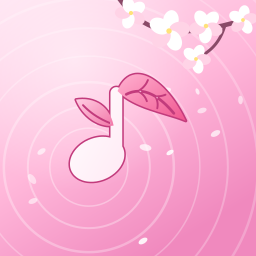<br>Sakura</td>
<td align="center">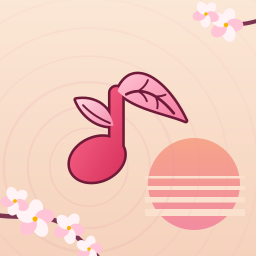<br>Sakura Retro</td>
<td align="center">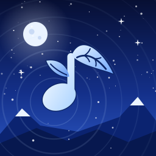<br>Frostwave</td>
<td align="center">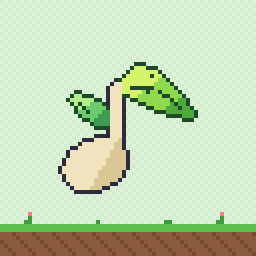<br>pixelart</td>
<td align="center"><br>Ramadhan</td>
<td align="center">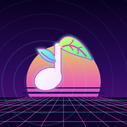<br>Neon Vibes</td>
</tr>
<tr>
<td align="center">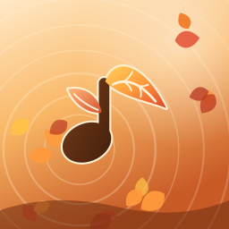<br>Autumn</td>
<td align="center">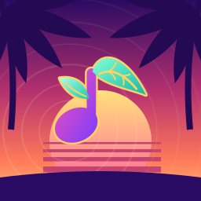<br>Synthwave</td>
<td align="center">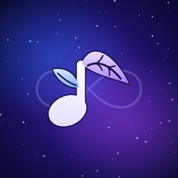<br>Infinity</td>
<td align="center">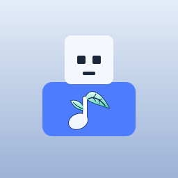<br>Guest</td>
<td align="center">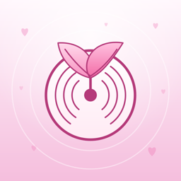<br>Marin Kitagawa</td>
<td align="center">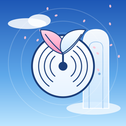<br>Suzume</td>
</tr>
<tr>
<td align="center">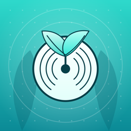<br>Hatsune Miku</td>
<td align="center">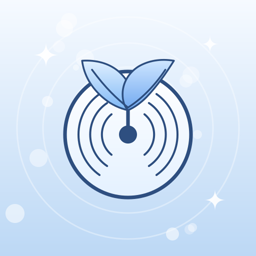<br>Kanade Tune</td>
<td align="center">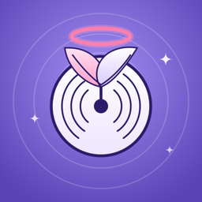<br>Kawaiitune</td>
<td align="center">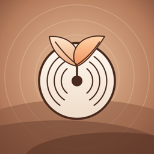<br>Depth</td>
<td align="center">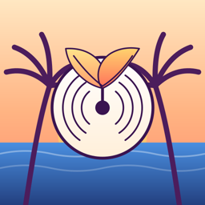<br>AT6</td>
<td align="center">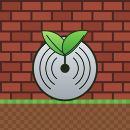<br>Minecraft</td>
</tr>
<tr>
<td align="center">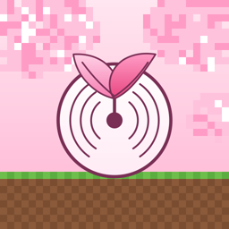<br>Minecraft Sakura</td>
<td align="center">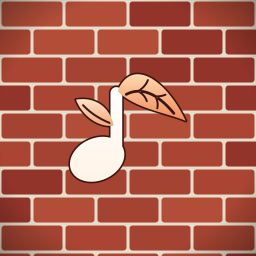<br>Bricks</td>
</tr>
</table>

## Credits

Redrawn and replaced icons are Natune artwork. Their palettes and motifs build on the upstream icons below; no traced artwork from these authors is reused. *Infinity* and *Guest* are new designs and reuse no upstream artwork.

| Upstream icon | Original author | Profile |
|---|---|---|
| Sakura, Sakura Retro | morieeattonkatsu, morrieeattonkatsu | [rukamori](https://github.com/rukamori) |
| Marin Kitagawa | raspweed | [raspweed](https://github.com/raspweed) |
| Frostwave - Japanese Winter, Suzume | Animesh | [agupta07505](https://github.com/agupta07505) |
| pixelart, Kanade Tune, Ramadhan, Minecraft | BunglonMewing | [BunglonMewing](https://github.com/BunglonMewing) |
| Hatsune Miku, Neon Vibes | ValteMCPE | [ValteMCPE](https://github.com/ValteMCPE) |
| Kawaiitune, Depth | cognitiveshadows03 | [cognitiveshadows03](https://github.com/cognitiveshadows03) |
| AT6, Bricks | DougAlvarenga | [dougalvarenga](https://github.com/dougalvarenga) |
| Minecraft Sakura | Sucuboy_u | [kpro199procreator](https://github.com/kpro199procreator) |

Upstream project and its contributors: [rukamori/IconPack](https://github.com/rukamori/IconPack).

## Format

`metadata.json` is a JSON array. Each entry needs:

- `Id`: unique 4- or 6-digit string. Never reuse an `Id` for a different icon; the app keys user selections by it.
- `Name`, `Author`: shown in the icon switcher.
- `Source`: an SVG basename in `svg/`.
- `GitHubAuthorUrl` (optional), `Link` (optional).
- `BackgroundMode` (optional): `integrated` or `transparent`; `BackgroundColor` (optional): literal hex.

SVG files must have a four-value `viewBox`, contain vector artwork, and avoid scripts, foreign objects, external references and DTDs. The app rasterizes each one at 512 px (see `GenerateIconPackTask` in NatuneGroup/ArchiveTune).

Previews are 256 px renders:

```sh
rsvg-convert --width 256 --height 256 --keep-aspect-ratio --output previews/<Id>.png svg/<Source>
```

## Contributing

Icon submissions are not accepted in this fork. Suggest an icon by opening an issue on [NatuneGroup/ArchiveTune](https://github.com/NatuneGroup/ArchiveTune/issues).

The submission workflow (`build.yml`) is disabled in this fork. The manual `update` and `remove` workflows remain; they need the `ICON_PACK_PAT` repository secret and only run on demand.

---

## License

Icon artwork in this repository is licensed under the terms in [LICENSE](LICENSE) (CC-BY-SA-4.0). Upstream's original icons keep their authors' rights and attributions above.
